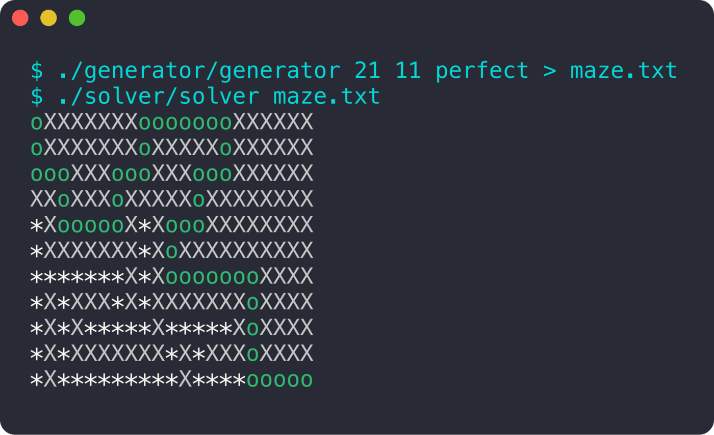

<div align="center">

# Dante's Star

**Générer des labyrinthes, puis les résoudre.**

 

<sub>Projet à 2 · 2023</sub>

</div>

<br/>

<p align="center"></p>

## Le projet en quelques mots

Deux programmes : un **générateur** qui crée des labyrinthes parfaits ou imparfaits de la taille qu'on veut, et un **solveur** qui trouve le chemin de l'entrée (en haut à gauche) à la sortie (en bas à droite) et le trace avec des `o`.

## Ce que ça fait

- Labyrinthes **parfaits** (un seul chemin entre deux cases) ou imparfaits
- Résolution par **parcours en largeur** (BFS)
- Tient de très grandes tailles
- Gestion des erreurs : arguments, format du labyrinthe, labyrinthe sans solution

## Lancer le projet

```bash
make
./generator/generator 21 11 perfect > maze.txt
./solver/solver maze.txt
```

## L'équipe

<a href="https://github.com/Wilson-Epitech/dante/graphs/contributors"></a>

Yanis Harkouk, Wilson Bordichon

**Ma partition :** J'ai écrit le **générateur** (création de la carte, vérification des voisins, gestion d'erreurs), la boucle de résolution du **solveur**, et la structure du projet.
